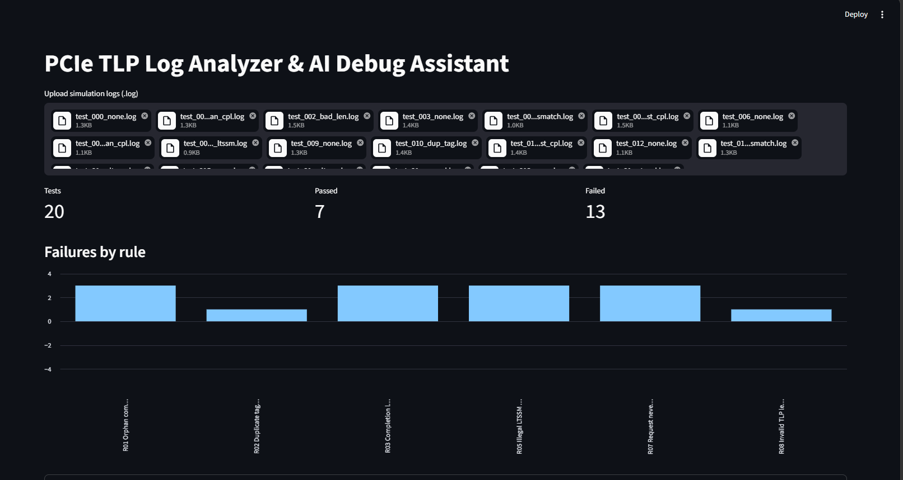

# PCIe TLP Log Analyzer & AI Debug Assistant

An AI-assisted verification-support tool that parses PCIe simulation logs, detects protocol violations, groups failures across a regression, and explains each one with a root cause, spec reference and suggested fix. It can run in parallel on a Slurm cluster.

> Built to cut the time RTL engineers spend triaging regression failures by hand.

## Pipeline

```
sim logs (.log) -> parser -> rules engine -> failure clustering -> explainer (KB + optional LLM) -> CLI / Streamlit dashboard
                                   ^
                      Slurm array job: one log per task, then `summarize` merges
```

## Rules implemented

| ID | Check |
|----|-------|
| R01 | Completion with no matching outstanding request (orphan) |
| R02 | Tag reused while still in flight |
| R03 | Completion length != request length |
| R04 | Completion timeout (configurable) |
| R05 | Illegal / discontinuous LTSSM transition |
| R06 | Completion with UR/CA status (warning) |
| R07 | Non-posted request never completed |
| R08 | Invalid TLP length (0 or > 1024 DW) |

## Quick start

```bash
pip install -r requirements.txt
python scripts/gen_logs.py --count 20          # synthetic logs with injected bugs
python -m pcie_debug.cli analyze logs/         # parallel analysis + summary
streamlit run app.py                           # dashboard (upload .log files)
pytest -q                                      # tests
```

### LLM explanations (optional)
```bash
export ANTHROPIC_API_KEY=...
python -m pcie_debug.cli analyze logs/ --llm
```
One LLM call per *failure type* (not per violation) keeps cost low. Without a key, the built-in knowledge base is used.

### Slurm
```bash
sbatch scripts/run_regression.sbatch           # array job, one log per task
python -m pcie_debug.cli summarize results/    # merge into summary.json
```

### Docker
```bash
docker build -t pcie-debug . && docker run -p 8501:8501 pcie-debug
```

## Log format
```
[1200ns] TX MRd addr=0x1000 len=4 tag=3
[1800ns] RX CplD tag=3 len=4 status=SC
[ 500ns] LTSSM Detect.Quiet -> Detect.Active
```

## Roadmap
- RAG over the public PCIe spec material for richer explanations
- Parsers for real simulator output (UVM logs, FSDB/VCD)
- Flow-control credit and ordering rules; Gen3+ equalization states
- Resume screening & marketing-content modules reusing the same LLM layer


## Dashboard Preview

Here is a screenshot of the PCIe Debug Assistant dashboard.


